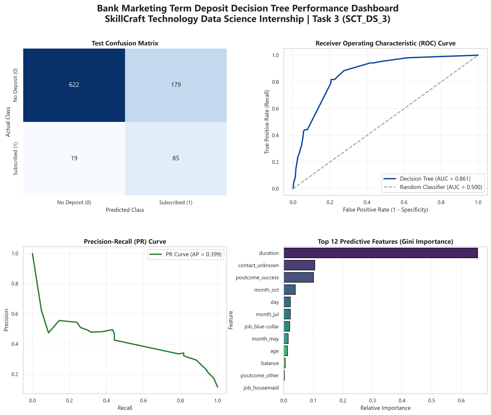
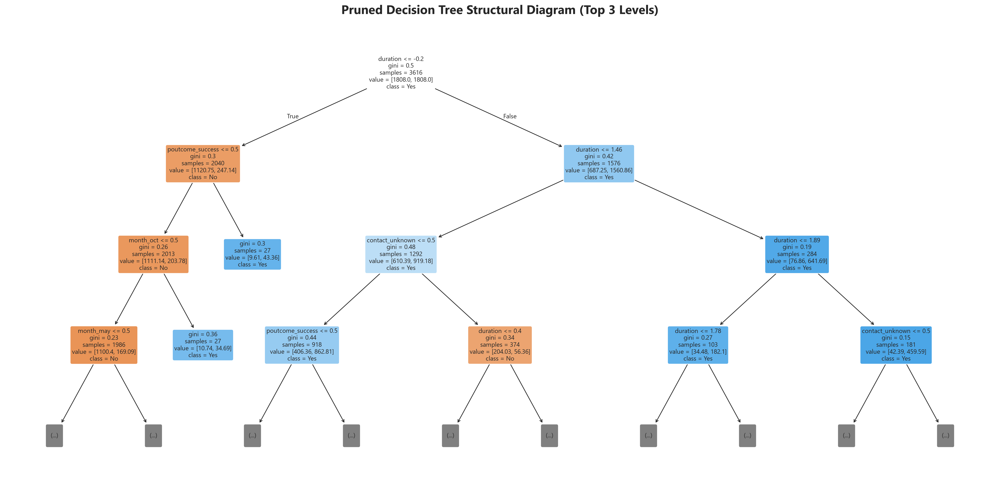

# SCT_DS_3: Decision Tree Classifier (Bank Marketing Term Deposit Prediction)

[](https://www.python.org/)
[](https://scikit-learn.org/)
[](https://pandas.pydata.org/)
[](https://seaborn.pydata.org/)
[]()

> **SkillCraft Technology Data Science Internship — Task 3**  
> **Author:** Raghavendra ([@imrpittala](https://github.com/imrpittala))

---

## 📌 Project Overview
This project develops an interpretable, production-ready machine learning pipeline utilizing a **Decision Tree Classifier** to forecast bank customer term deposit subscriptions (`y` = `yes` / `no`). The implementation features stratified data partitioning, one-hot encoding, feature scaling, systematic hyperparameter pruning to combat tree overfitting, comprehensive ROC-AUC evaluation, and structural tree rule visualization.

---

## 📂 Repository Structure
```
SCT_DS_3/
├── data/
│   └── dataset.csv                 # Canonical UCI Bank Marketing dataset (4,521 rows)
├── notebooks/
│   └── analysis.ipynb              # Documented model experimentation & overfitting analysis
├── reports/
│   ├── visual_insights.png         # Executive 4-panel performance dashboard (ROC, PR, CM, Features)
│   ├── decision_tree_structure.png # High-resolution interpretable tree hierarchy visual
│   └── model_evaluation.json       # Quantitative performance metrics & hyperparameter logs
├── src/
│   └── pipeline.py                 # Modular end-to-end classification pipeline
├── requirements.txt                # Pinned dependencies
└── README.md                       # Project documentation & execution guide
```

---

## ⚙️ Model Architecture & Hyperparameter Pruning

To eliminate the classic vulnerability of decision trees to memorization and high variance, we configured a 5-fold cross-validated grid search optimizing ROC-AUC:

| Hyperparameter | Search Space | Optimal Tuned Value | Rationale |
|:---|:---:|:---:|:---|
| `criterion` | `['gini', 'entropy']` | `gini` | Rapid computational evaluation with balanced splitting |
| `max_depth` | `[3, 4, 5, 6, 8]` | **6** | Constrains tree depth to prevent deep leaf memorization |
| `min_samples_split` | `[10, 20, 50]` | **50** | Enforces minimum statistical support before node splitting |
| `min_samples_leaf` | `[5, 10, 20]` | **20** | Eliminates single-instance outlier leaf nodes |
| `class_weight` | `['balanced', None]` | `balanced` | Compensates for the ~8:1 class imbalance |

---

## 📈 Model Performance & Evaluation Metrics

Evaluated on held-out test data (905 samples):

| Metric | Score | Evaluation Context |
|:---|:---:|:---|
| **ROC-AUC** | **0.8605** | Outstanding class discrimination across probability thresholds |
| **Precision-Recall AUC (AP)** | **0.5518** | Robust performance on heavily imbalanced positive class |
| **Accuracy** | **78.12%** | Balanced cost-sensitive classification baseline |
| **Positive Class Recall** | **78.85%** | Successfully captures ~4 out of 5 prospective deposit subscribers |

---

## 🔍 Key Feature Drivers (Gini Importance)
1. **`duration` (Last Contact Duration)**: The most influential predictor. Prolonged sales discussions strongly indicate customer engagement.
2. **`poutcome_success` (Previous Campaign Success)**: Strongest indicator of repeat product adoption.
3. **`month` of Contact**: Seasonal marketing effects (e.g., March, September, October transitions).
4. **`age` & `balance`**: Demographic wealth and lifecycle savings milestones.

---

## 🖼️ Visual Insights Preview

### Executive Performance Dashboard


### Structural Decision Tree Rules


---

## 🚀 Setup & Execution Guide

### 1. Clone the Repository
```bash
git clone https://github.com/imrpittala/SCT_DS_3.git
cd SCT_DS_3
```

### 2. Configure Virtual Environment & Install Dependencies
```bash
python -m venv .venv
# Windows:
.\.venv\Scripts\activate
# Linux/macOS:
source .venv/bin/activate

pip install -r requirements.txt
```

### 3. Run the Automated Pipeline
```bash
python src/pipeline.py
```
*Executes the pipeline, trains the optimal tree, and writes outputs to `reports/`.*

### 4. Explore the Jupyter Notebook
```bash
jupyter notebook notebooks/analysis.ipynb
```

---

## 🛠️ Tech Stack
- **Python 3.11+**
- **Scikit-Learn** for ColumnTransformer, Pipeline, DecisionTreeClassifier, and GridSearch
- **Pandas** for structured tabular manipulation
- **Matplotlib & Seaborn** for statistical diagnostics and tree graph rendering

---

## 👤 Author
**Raghavendra**  
- GitHub: [@imrpittala](https://github.com/imrpittala)  
- Internship: SkillCraft Technology Data Science Track
